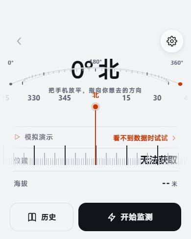

<h1>指南针测速 · Compass Speed</h1>

**一个能真正陪着走一段路的安卓小工具。** 打开就能看见北方在哪，抬手就知道自己走多快。

GPS 实时测速 · 磁力指南针 · 轨迹回放 · 海拔与爬升 · 步数统计 · TCX 导入导出

<a href="../../releases/latest"></a>

<a href="LICENSE"></a>


<br clear="right">

> 界面全部跑在 WebView 里，同一份 HTML 也能在电脑浏览器直接打开当网页版用 —— 也就是说，这个 App 的界面，你在电脑上就能先看一眼。

---

## 这是什么

一个安卓运动测速 App，把手机变成一个随身的测速仪 + 指南针 + 轨迹记录仪。

它做的事情很朴素：**告诉你朝哪走、走多快、走了多远、爬升了多少**。

界面不用原生控件画，而是用 HTML/CSS/JS 写在 WebView 里；外面套一层 Kotlin 原生壳，负责去问系统要 GPS 和传感器的数据。好处是界面能做得足够自在，改起来也快 —— 改一个 `app.html`，网页版和 APK 同时生效。

---

## 功能

| 功能 | 说明 |
|---|---|
| **指南针** | 横向刻度带 + 双弧进度线，旋转矢量三层滤波（低通 / 3° 死区 / 180ms 时间确认） |
| **测速** | GPS 实时速度，自动判断交通方式（走 / 骑 / 电动 / 汽车 / 火车 / 飞机） |
| **轨迹图** | 按速度着色，支持双指缩放与拖动 |
| **历史记录** | 左滑删除，点开查看完整报告 |
| **数据报告** | 速度曲线、海拔曲线、分段统计 |
| **导入导出** | TCX 导入 / 导出，FIT 导出 |
| **设置** | 6 种速度单位、深浅色主题、手动锁定运动方式 |

## 传感器用途

| 传感器 | 用途 |
|---|---|
| 旋转矢量 | 指南针方向 |
| 加速度计 | 运动状态判断，辅助 GPS |
| 气压计 | 海拔（比 GPS 准，±1m 级） |
| 计步器 | 步数统计 |

定位用 `LocationManager`，同时监听 GPS 与网络定位。GPS 断开 3.5 秒内无更新时切到传感器推算（最多 30 秒）。精度差时会自动放大轨迹过滤阈值，避免把抖动画成乱线。

## 网页 ↔ 原生通信

- 网页 → 原生：`window.AndroidBridge.xxx()`
- 原生 → 网页：`window.__native_onXxx(data)` 回调

---

## 项目结构

```
.
├── android/                       安卓工程（Android Studio 可直接打开）
│   ├── app/
│   │   ├── src/main/
│   │   │   ├── java/com/example/compass/
│   │   │   │   └── MainActivity.kt      原生壳：WebView + GPS + 传感器 + 导出
│   │   │   ├── assets/app.html          界面（HTML/CSS/JS 全部在这里）
│   │   │   ├── res/                     图标、主题、字符串
│   │   │   └── AndroidManifest.xml      权限声明
│   │   └── build.gradle.kts
│   ├── build.gradle.kts
│   ├── settings.gradle.kts
│   └── gradle.properties
├── web/                           网页版
│   ├── index.html
│   └── tokens.css                 设计变量（颜色、圆角、字号）
├── LICENSE
└── README.md
```

## 编译

需要 **JDK 21** + **Android SDK**（compileSdk 35）。

### 1. 配置 SDK 与签名

在 `android/` 目录下新建 `local.properties`（**该文件不进版本库**）：

```properties
sdk.dir=/你的/Android/Sdk

# 以下为可选：不配签名也能编译，只是产出未签名包
storeFile=../compass-release.jks
storePassword=你的密码
keyAlias=compass
keyPassword=你的密码
```

### 2. 生成自己的签名证书（可选）

```bash
keytool -genkeypair -v \
  -keystore compass-release.jks \
  -alias compass \
  -keyalg RSA -keysize 2048 -validity 9125 \
  -dname "CN=Compass Speed, O=Compass Speed, C=CN"
```

> ⚠️ **证书一旦用于发布就无法更换**——换了证书，老用户必须卸载重装才能升级，且本地数据会丢。请妥善备份 `.jks` 文件，**绝不提交到仓库**。

### 3. 编译

```bash
cd android
./gradlew assembleRelease
```

产物：`app/build/outputs/apk/release/app-release.apk`

### 网页版

直接用浏览器打开 `web/index.html`（需同目录有 `tokens.css`）。

> ⚠️ 浏览器定位需要 **HTTPS** 或 `localhost`，用 `file://` 打开拿不到 GPS。

## 修改界面

界面全部在 `android/app/src/main/assets/app.html`（APK）和 `web/index.html`（网页版）里。

- 网页：改完刷新
- APK：把改好的 `app.html` 复制到 `app/src/main/assets/`，重新编译

设计变量（配色、圆角、字号）在 `web/tokens.css`，APK 里的 `app.html` 已内联同一份。

---

## 已知限制

1. **FIT 只能导出**——FIT 是二进制协议，暂未实现导入解析
2. **室内定位不准**——GPS 物理限制，不是 bug
3. **切到后台会暂停定位**——Android 系统限制，运动时请保持前台
4. **没有心率**——手机无此硬件，需要蓝牙心率带
5. **爬升是估算值**——有气压计时才比较准

## 许可

[MIT](LICENSE)

---

# Compass Speed

An Android app for **compass heading, GPS speed and track recording**. The UI is plain HTML/CSS/JS running inside a native WebView shell that bridges GPS and sensors.

Same HTML also works as a standalone web page in a desktop browser.

**Build:** JDK 21 + Android SDK (compileSdk 35), then `cd android && ./gradlew assembleRelease`.
**Signing:** place `local.properties` with your keystore — never commit `.jks` files.
**Web version:** open `web/index.html`; geolocation requires HTTPS or localhost.

Licensed under the [MIT License](LICENSE).
